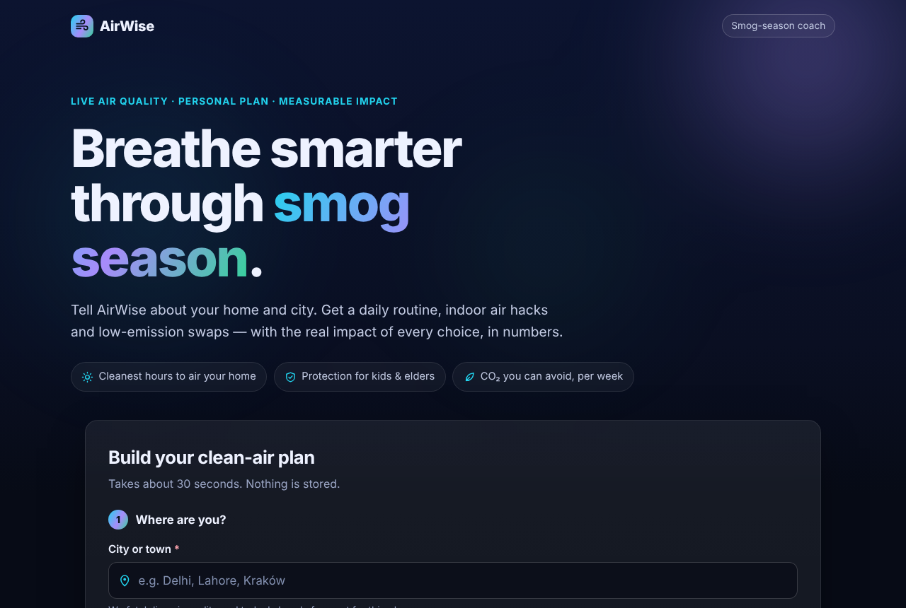
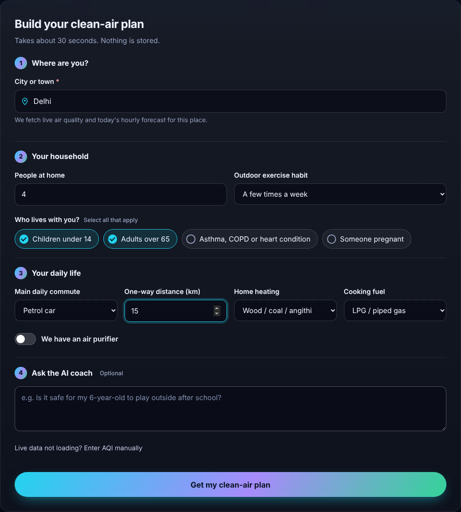
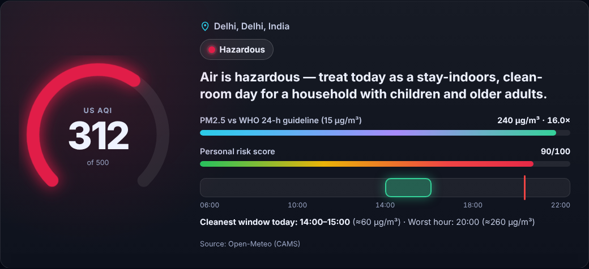
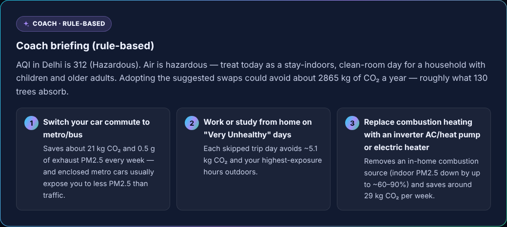
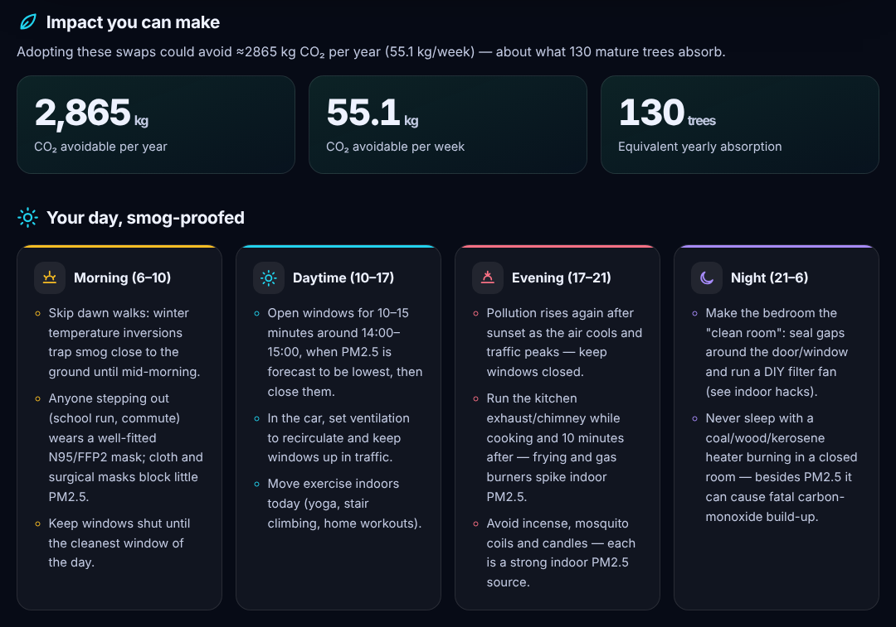
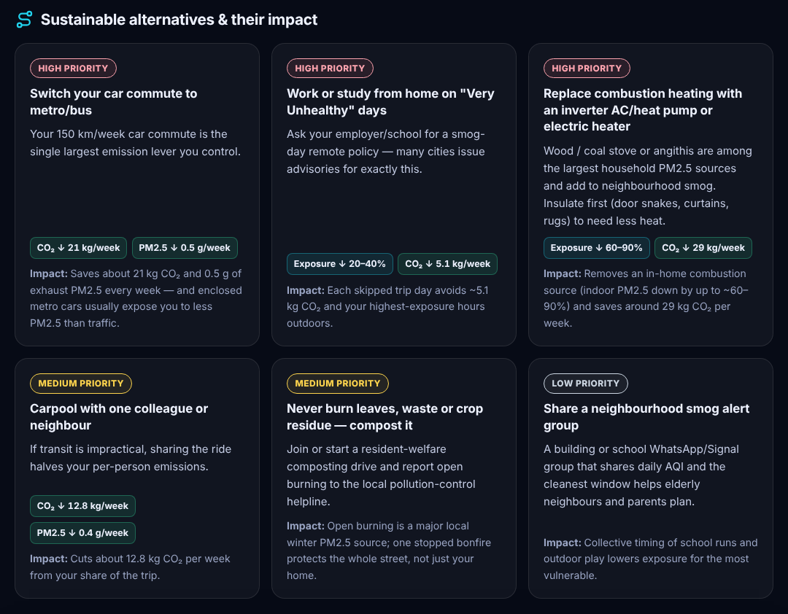
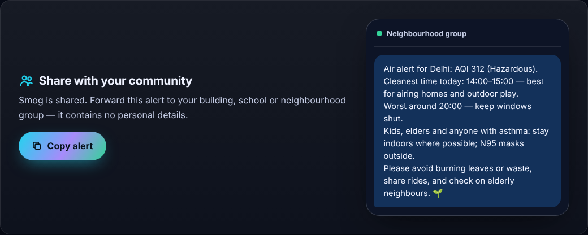
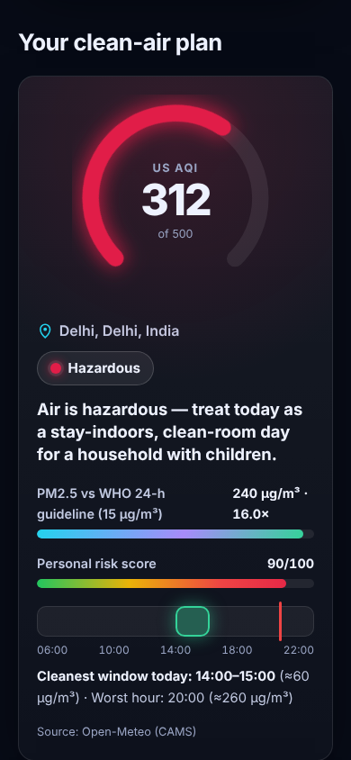

# AirWise: a clean-air coach for smog season 🌫️

[](https://render.com/deploy?repo=https://github.com/MdIbuA/Airwise)



AirWise is a GenAI-powered assistant for families and communities living through severe winter smog and urban air pollution. You enter your city and a short household profile. AirWise then:

- fetches **live air quality and today's hourly PM2.5 forecast** for that place,
- works out a **personal risk level** for the household,
- builds a **low-emission daily routine** that tells you when to ventilate, when to exercise and when to mask up,
- suggests **indoor air-quality hacks** that fit what you already own,
- recommends **sustainable alternatives** (commute, heating, cooking, community action),
- and **puts a number on the impact** of each choice: how much exposure drops (%), how much CO₂ is avoided (kg/week) and how much exhaust PM2.5 is avoided (g/week).

It also produces a **shareable community alert** with no personal details. You can forward it to a building, school or neighbourhood group, so one family's plan protects the people around them.

**Google Gemini** (or Claude, if configured) writes a short briefing from these results, lists the household's top three actions and answers the user's own question in plain language.

---

## Screenshots

> Captured from the running app (`npm start`) for a sample Delhi household: children and older adults at home, a 15 km petrol-car commute and a coal heater.
> - **Air data:** a recorded hazardous-day sample (AQI 312), the same fixture the tests use, because live Open-Meteo access was blocked in the capture environment.
> - **Briefing:** shown in rule-based mode. With a Gemini key set, the same card is titled "AI coach briefing" and also answers the user's question.

**1. Stepped household form**: chip toggles for sensitive members, plus commute, heating and cooking choices.



**2. Air quality at a glance**:
- An AQI ring gauge. The band colour is always paired with its name.
- PM2.5 against the WHO guideline, and the personal risk score.
- A day strip with today's cleanest window in green and the worst hour in red.



**3. Coach briefing**: the top three actions for this household, each with its direct impact.



**4. Impact and a smog-proofed day**:
- Avoidable CO₂ and its tree equivalent.
- A routine from morning to night.



**5. Sustainable alternatives**: prioritised swaps with quantified exposure, CO₂ and PM2.5 reductions.



**6. Community alert**: a shareable message with no personal details, for building, school or neighbourhood groups.



<details>
<summary><strong>Mobile view</strong> (390 px)</summary>



</details>

---

## How it maps to the evaluation criteria

| Criterion | What we did | Where |
|---|---|---|
| **Problem statement alignment** | <ul><li>Live, location-specific AQI and hourly forecast.</li><li>Advice adjusted to the household's lifestyle: sensitive members, commute, heating, cooking, purifier, exercise.</li><li>Low-emission routine, indoor hacks and sustainable swaps, each with a **quantified impact** (exposure %, CO₂ kg/week, PM2.5 g/week).</li><li>A community alert for families *and communities*.</li><li>GenAI briefing and Q&A (Gemini), with backup-key failover.</li></ul> | `recommendationEngine.js`, `assistant.js` |
| **Code quality** | <ul><li>Layered design: routes, services, a pure rule engine and reference data.</li><li>Dependency injection, so the app is testable offline.</li><li>JSDoc on public functions; ESLint (flat config) enforced in CI.</li><li>Small, single-purpose modules.</li></ul> | `src/`, `eslint.config.js` |
| **Security** | <ul><li>Allow-list validation.</li><li>Strict CSP and Permissions-Policy via helmet.</li><li>Per-IP rate limits, tighter on the LLM-backed endpoint.</li><li>Prompt-injection fencing and a schema-validated LLM output.</li><li>The API key stays on the server.</li><li>Non-root container and `npm audit` in CI.</li></ul> | `SECURITY.md`, `app.js`, `validation.js` |
| **Efficiency** | <ul><li>TTL + LRU caches for geocoding (24 h), air quality (15 min, ~1 km grid) and LLM output (15 min).</li><li>In-flight request de-duplication.</li><li>gzip compression; 6 s upstream timeouts.</li><li>Progressive loading: the plan renders in well under a second, and the AI briefing streams in afterwards within a 12 s budget (background-cached if slower).</li><li>Small LLM call with minimal thinking and a capped output, since it only narrates facts that are already computed; only the configured vendor SDK is loaded.</li><li>No front-end framework (≈10 kB of JS); 6 runtime dependencies.</li></ul> | `cache.js`, `airQuality.js`, `assistant.js` |
| **Testing** | <ul><li>**81 unit/API tests** (~99% line coverage), fully offline.</li><li>**8 browser E2E tests** covering the full flow, progressive AI loading, keyboard-only use, clipboard, a 320 px layout and the error path.</li><li>All run in CI.</li></ul> | `tests/`, `.github/workflows/ci.yml` |
| **Accessibility** | <ul><li>**Automated axe-core WCAG 2.1 AA scan with zero violations** on the form and on the results page, in light and dark mode.</li><li>Labelled controls, skip link, live region, focus management.</li><li>Colour plus text for severity; 44 px targets; reduced motion; works at 320 px.</li></ul> | `public/`, `tests/e2e/ui.e2e.js` |

---

## Chosen vertical

**Persona:** a family or community member in a smog-affected city, such as a parent in Delhi, Lahore, Dhaka or Kraków. They have to make everyday decisions: *Can my child play outside? Should I open the windows? Is my commute making things worse?*

**Logic focus:** decisions that depend on context. The same AQI leads to different advice for a household with an asthmatic grandparent and a coal heater than for a healthy couple who work from home.

---

## Approach and logic

AirWise uses a **"rules decide, AI explains"** architecture:

```
Browser (accessible form)
   │  POST /api/plan  (validated, allow-listed profile)
   ▼
Express API ──► Air-quality service ──► Open-Meteo geocoding + air-quality (CAMS)
   │                (TTL cache, 6 s timeout, cleanest-window analysis)
   ▼
Recommendation engine (deterministic, unit-tested)
   │  risk • routine • indoor hacks • alternatives • quantified impact
   ▼
GenAI assistant (Gemini by default / Claude, JSON-schema output, grounded on engine facts)
   │  briefing • top 3 actions • answer to user question
   │  └─ primary key → backup key → rule-based template (never fails)
   ▼
JSON response ──► rendered with DOM APIs only (no innerHTML)
```

### Why split it this way?
| Concern | Rule engine | LLM |
|---|---|---|
| Health thresholds and numbers | ✅ deterministic, testable, auditable | ❌ could hallucinate |
| Empathetic, readable explanation | ❌ rigid | ✅ |
| Free-text questions | ❌ | ✅ |
| Works without network or an API key | ✅ | ❌ |

Every number the user sees comes from the engine. The model is only allowed to use numbers that appear in the plan.

### Decision logic (`src/services/recommendationEngine.js`)
1. **AQI band:** US EPA breakpoints (Good → Hazardous).
2. **Personal risk:**
   - Households with sensitive members (children, people over 65, asthma/COPD/heart conditions, pregnancy) are treated **one band higher**.
   - Solid-fuel heating or cooking adds another level, because indoor combustion raises exposure even on clean days.
   - The 0–100 score also takes outdoor-exercise habits into account.
3. **Routine:**
   - The day is split into morning, daytime, evening and night.
   - Uses the **cleanest 2-hour forecast window** (computed from hourly PM2.5) for ventilation and exercise.
   - Avoids dawn hours, when winter temperature inversions trap smog near the ground.
   - Recommends masks at AQI ≥ 151, or ≥ 101 when sensitive members are present.
   - Exercise moves indoors from the "Unhealthy" level.
   - Warns about carbon monoxide when a coal, wood or kerosene heater is in use.
4. **Indoor hacks:**
   - Households with a purifier get placement and sizing advice: CADR ≈ room volume × 5 air changes per hour.
   - Households without one get a DIY box-fan + MERV-13 filter design.
   - Also covers sealing gaps, timing ventilation by the forecast, wet cleaning and removing incense/mosquito-coil smoke.
   - Includes a myth check on house plants.
5. **Alternatives with impact:**
   - Car → metro/bus: (EF_car − EF_transit) × weekly km.
   - Carpooling: halves per-person emissions.
   - Two-wheeler → transit on bad days.
   - Work from home on days rated "Unhealthy" or worse.
   - Clean heating and cooking fuel swaps.
   - Community actions: no open burning, a neighbourhood alert group.
6. **Community alert:** a short message with no personal details. It covers the AQI, the cleanest and worst hours and group-specific advice, and asks neighbours not to burn waste and to check on elderly people. A copy/share button sends it to group chats.
7. **Impact summary:** total CO₂ avoided per week and per year, plus a tree-equivalent. Mutually exclusive options such as carpool vs. transit are not double-counted.

### GenAI layer (`src/services/assistant.js`)
- **Provider:** **Google Gemini** (`gemini-3.8-flash`) via the official `@google/genai` SDK by default. It handles model problems automatically:
  - **Retired or unavailable model (HTTP 404):** AirWise moves to the next model in its list (`gemini-3.8-flash` → `3.7-flash` → `3.6-flash` → `3.5-flash` → `3.5-flash-lite` → `gemini-flash-latest` → `gemini-flash-lite-latest`) and keeps using it.
  - **Overloaded model or timeout (HTTP 500/503/504):** AirWise retries once, then answers that request with the next model. Next time it goes back to the preferred model. **Claude** (`claude-opus-5-5`) via `@anthropic-ai/sdk` is also supported. Both sit behind one small adapter interface (`src/services/llmProviders.js`), so the rest of the app is vendor-neutral. Choose with `AIRWISE_LLM_PROVIDER` and `AIRWISE_MODEL`.
- **Structured outputs:** a JSON schema (Gemini `responseJsonSchema`, Claude `output_config.format`) guarantees the shape `{summary, priorities[], answer}`, and the response is validated again on the server.
- **Grounded prompt:** the model receives the engine's plan as JSON and must not invent statistics.
- **Prompt-injection defence:** the user's question goes inside `<user_question>` tags and is labelled as data. Off-topic requests are declined.
- **Speed: progressive loading.** The plan never waits for the LLM:
  - `/api/plan` returns the full plan with a rule-based briefing in a few hundred milliseconds.
  - The page then asks `/api/narrative` for the AI briefing. The coach card shows a "writing" state and is upgraded in place when the AI answers.
  - The AI has a **12-second total budget**. If it runs over, the rule-based briefing stays, the AI call finishes in the background, and its result is cached, so asking again is instant.
  - Gemini 3 models run with **minimal thinking**, because the facts are already computed. If a model rejects that setting, AirWise switches to `LOW` automatically.
- **Efficiency:**
  - Low reasoning effort, because the model only narrates facts that are already computed.
  - Responses are cached for 15 minutes, keyed by a SHA-256 hash of the inputs.
  - The prompt payload is minimal and contains no personal data beyond the city.
- **Resilience:**
  - **Backup API key failover:** if the primary key is rejected (401/403, including Gemini's "API key not valid" 400), out of credits (402), rate-limited or out of quota (429), overloaded (5xx) or unreachable, the request is retried once with the backup key. Bad requests and safety stops are not retried, because they would fail the same way.
  - Claude also uses server-side model fallback.
  - Timeout and a single retry.
  - On a refusal, error or malformed output, the user still gets a rule-based briefing (`source: "rules"`).

---

## How it works (run it)

Requirements: Node.js 20.12+ (22 recommended). AirWise loads `.env` automatically with Node's built-in parser; real environment variables take precedence.

**macOS / Linux**
```bash
npm install
cp .env.example .env        # then edit .env: GEMINI_API_KEY=... (+ GEMINI_API_KEY_BACKUP=...)
npm start                   # http://localhost:8080
```

**Windows (Command Prompt / PowerShell)**
```bat
npm install
copy .env.example .env
notepad .env
npm start
```
In Notepad, fill in `GEMINI_API_KEY=` and `GEMINI_API_KEY_BACKUP=` and save. Don't type these lines into the terminal.

Without an API key, AirWise still works fully in **rule-based mode**. If the air-quality API is unreachable, open *"Enter AQI manually"* in the form.

### Quality checks
```bash
npm run lint            # ESLint
npm test                # 81 unit + API tests (node:test, fully offline)
npm run test:coverage   # ~99% line coverage of src/
npm run test:e2e        # browser E2E + axe-core WCAG 2.1 AA scan (needs Chromium: npx playwright install chromium)
npm run check           # all of the above
npm run check:ai        # live test of your Gemini/Claude keys
```
- **Unit and API tests:** validation, the cache, every branch of the decision engine and the community alert. Also air-quality parsing and caching, and the LLM success/caching/fallback paths.
- **HTTP tests:** run end-to-end, covering security headers, gzip, 400/404/413/429/503 handling, the tighter plan rate limit and the manual-AQI flow.
- **Browser tests:** drive the real UI in Chromium.

### Is the AI working?
```bash
npm run check:ai
```
This sends one tiny test request per configured key. It reports whether each key works and, if one doesn't, the reason with a fix: key rejected, API not enabled, quota reached, model not found or overloaded, or network blocked. It also lists the Gemini text models your key can use. Keys are never printed. When AI is unavailable, the app shows a rule-based briefing, and the server log explains why.

### Environment variables
| Variable | Required | Purpose |
|---|---|---|
| `GEMINI_API_KEY` (or `GOOGLE_API_KEY`) | No | Turns on Gemini briefings and Q&A |
| `GEMINI_API_KEY_BACKUP` (or `GOOGLE_API_KEY_BACKUP`) | No | Failover key, used only if the primary fails |
| `ANTHROPIC_API_KEY` / `ANTHROPIC_API_KEY_BACKUP` | No | Use Claude instead (picked automatically when no Google key is set) |
| `AIRWISE_LLM_PROVIDER` | No | `gemini` or `anthropic`, to force a provider |
| `AIRWISE_MODEL` | No | Model override (defaults: `gemini-3.8-flash`, `claude-opus-5-5`) |
| `PORT` | No | HTTP port (default 8080) |
| `AIRWISE_RATE_LIMIT` | No | API requests/min per IP (default 30; `/api/plan` gets a third) |
| `AIRWISE_DISABLE_LLM` | No | `true` forces rule-based mode |
| `AIRWISE_AI_BUDGET_MS` | No | Max total wait for the AI briefing (default 12000) before the rule-based one is kept |
| `AIRWISE_LLM_TIMEOUT_MS` | No | Timeout for a single model call (default 10000) |

Keys are read only on the server. Never commit `.env` (it is git-ignored); on a cloud host, use its secret manager.

### Deploy to Render (free, ~5 minutes)
The repo includes a [`render.yaml`](render.yaml) blueprint:
- A Node 22 web service on the free plan.
- Production-only install.
- Health check at `/api/health`.
- Auto-deploy on every push to `main`.

1. Click the **Deploy to Render** button at the top of this README, then sign in to Render with GitHub.
2. When prompted, paste `GEMINI_API_KEY` and `GEMINI_API_KEY_BACKUP`. Both are optional; without them the app runs in rule-based mode.
3. Click **Apply**. Your app goes live at `https://airwise-xxxx.onrender.com`.

Free instances sleep after about 15 minutes idle, so the first request after that takes around 30 seconds.

### Docker / Cloud Run
```bash
docker build -t airwise .
docker run -p 8080:8080 -e GEMINI_API_KEY=... -e GEMINI_API_KEY_BACKUP=... airwise
```

### API
| Method | Path | Purpose |
|---|---|---|
| `GET` | `/api/health` | Liveness |
| `GET` | `/api/options` | Allowed enum values |
| `GET` | `/api/air?city=Delhi` | Live AQI, pollutants, cleanest window |
| `POST` | `/api/plan` | Full personalised plan + rule-based briefing, returned instantly (no LLM wait) |
| `POST` | `/api/narrative` | AI briefing for the same profile (time-boxed; tighter rate limit) |

---

## Security
- **Input:** allow-list validation for every field (enums, numeric ranges, a Unicode-aware city pattern, 500-character question limit). Unknown fields are dropped.
- **Headers:** `helmet` with a strict **Content-Security-Policy** (`'self'` only, no inline scripts or styles), `frame-ancestors 'none'`, `nosniff`; `x-powered-by` is disabled.
- **Abuse limits:** a 10 kB JSON body limit, plus **rate limiting** on `/api` (30 requests/min per IP by default). The LLM-backed `/api/plan` gets a third of that, to cap cost.
- **Browser features:** a `Permissions-Policy` header disables camera, microphone, geolocation, payment and USB.
- **XSS:** the front end renders with `textContent` and DOM APIs only, so model output cannot inject HTML.
- **Secrets and errors:** the API key stays on the server and is read from the environment. Errors are centralised and only safe messages reach clients. Logs never include prompts or keys.
- **Container:** non-root user with a health check, production-only dependencies.
- **Supply chain:** CI runs `npm audit` on every push. See [SECURITY.md](SECURITY.md).

## Accessibility
- Semantic landmarks, a skip link, a `<label>` for every control and `fieldset`/`legend` groups.
- Results sit in an `aria-live` region with `aria-busy`. Focus moves to the results heading, and errors use `role="alert"` and `aria-invalid`.
- AQI severity is shown **as text as well as colour**. Visible focus rings, 44 px touch targets.
- Supports `prefers-color-scheme` (dark mode) and `prefers-reduced-motion`. Readable at 200% zoom with a responsive grid.
- **Verified automatically:** an axe-core WCAG 2.1 AA scan (zero violations in light and dark mode), keyboard-only navigation and a 320 px viewport are all tested in CI.

## Project structure
```
src/
  server.js                 # entry point, graceful shutdown
  app.js                    # Express app factory (dependency-injected)
  config.js                 # env-driven config
  data/factors.js           # AQI bands, emission & exposure factors
  services/
    airQuality.js           # Open-Meteo client + forecast analysis
    recommendationEngine.js # decision logic
    assistant.js            # grounded LLM narrative, key failover, rule fallback
    llmProviders.js         # Gemini + Claude adapters (same interface)
  utils/                    # validation, TTL cache, errors
public/                     # accessible vanilla-JS front end
docs/screenshots/           # README images (captured from the running app)
tests/                      # node:test unit + API suites
tests/e2e/                  # Playwright + axe-core browser tests
```

## Assumptions
- **AQI scale:** AirWise uses the **US EPA AQI** reported by Open-Meteo (Copernicus CAMS model data). Local scales such as India's NAQI differ slightly. CAMS readings are modelled at roughly 10–40 km resolution, so they are not a street-level sensor reading.
- **Emission factors** (CO₂ per passenger-km): petrol car 0.17 kg, diesel car 0.16 kg, two-wheeler 0.06 kg, bus/metro 0.03 kg. Exhaust PM2.5 factors are rounded published averages. Commutes are assumed to be **2 trips/day × 5 days/week**, and the distance entered is one-way.
- **Heating:** weekly CO₂ for heating types is an indicative winter average for a single room.
- **Exposure reductions:** given as **ranges** drawn from published studies (HEPA/DIY filters in closed rooms, clean-cooking interventions). Real results depend on room size, sealing and behaviour.
- **Tree equivalent:** about 22 kg CO₂ absorbed per mature tree per year.
- **Community alert:** it deliberately omits household details (health conditions, fuels, commute), so it is safe to share publicly.
- **Not medical advice:** the app gives general guidance, and the AI is instructed to send symptom questions to a doctor.
- **Sensitive members:** a household that reports any of them is treated conservatively.
